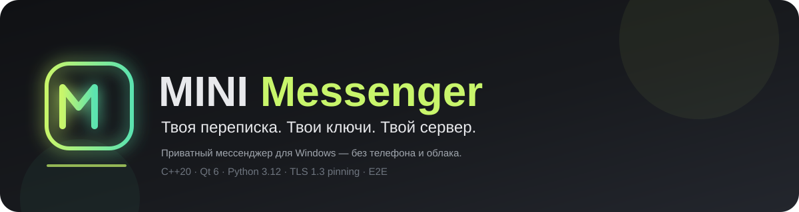
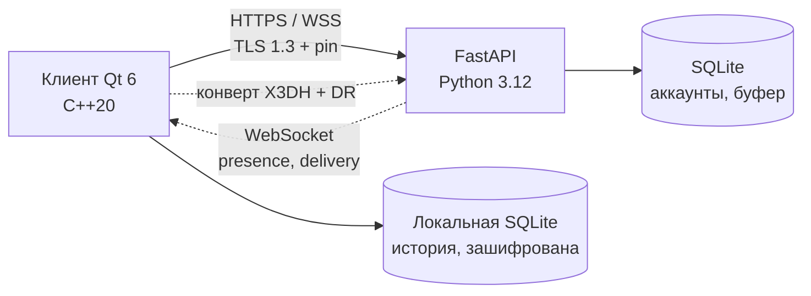

<p align="center">
  
</p>

<h1 align="center">MINI Messenger</h1>

<p align="center">
  <b>Свой мессенджер для «своих»: логин, пароль и файл <code>sign.in</code> — без телефона и почты.</b><br>
  Клиент на C++20/Qt 6, сервер на Python 3.12/FastAPI, TLS 1.3 с пиннингом и сквозное шифрование личных чатов.
</p>

<p align="center">
  <a href="https://github.com/Wharner-APP/MINI-Mwssenger/releases"></a>
  
  
  
  
  
</p>

<p align="center">
  <a href="#-что-это">Что это</a> ·
  <a href="#-возможности">Возможности</a> ·
  <a href="#-быстрый-старт">Быстрый старт</a> ·
  <a href="#-сборка-из-исходников">Сборка</a> ·
  <a href="#-архитектура">Архитектура</a> ·
  <a href="#-дорожная-карта">Дорожная карта</a> ·
  <a href="#-ограничения">Ограничения</a>
</p>

> [!NOTE]
> Это учебный проект. Он не связан с MINI/BMW, Telegram или другими продуктами.

```text
CURRENT TUNNEL: (not running)
```

Строку выше обновляет `scripts/run_bore.ps1`; клиент читает её из README при запуске, чтобы найти сервер.

---

## ✨ Что это

MINI Messenger — настольный мессенджер, который не просит телефон, почту и не отправляет историю в облако. Аккаунт — это логин, пароль и файл-ключ `sign.in`. Сервер только передаёт зашифрованные конверты и не может прочитать переписку.

| Принцип | Как это выглядит |
|---|---|
| **Сообщения принадлежат тебе** | история лежит локально, в зашифрованной SQLite |
| **Сервер — релей, а не архив** | конверт живёт до подтверждения доставки, потом удаляется |
| **Вход без телефона** | логин + пароль + `sign.in` |
| **Слабое железо — не оправдание** | 60 FPS на GT 630 при 1280×1024 |
| **Честность** | что не E2E — помечено; что не входит — написано |

## 🚀 Возможности

<details open>
<summary><b>Вход и аккаунт</b></summary>

- Регистрация по логину и имени, без телефона и почты.
- Пароль от 8 до 128 символов, Argon2id на клиенте и сервере.
- `sign.in` — 5 слов, 10 букв и 5 символов; при создании показывается предупреждение.
- Вход только по логину, паролю и файлу; чужой или повреждённый файл не пускает.
- Список устройств, завершение сессии, смена пароля, перегенерация `sign.in`, удаление аккаунта.
- hCaptcha внутри окна; если провайдер недоступен — встроенная капча.

</details>

<details open>
<summary><b>Личные чаты</b></summary>

- Поиск человека по точному логину и открытие ЛС.
- Текст, ответы, копирование, удаление у себя, отмена отправки 5 секунд.
- Статусы: часы → одна галочка → две → прочитано.
- Черновики на каждый чат.
- Список чатов: превью, время, непрочитанные, закрепление, mute, фильтры, контекстное меню.
- Глобальный поиск <kbd>Ctrl</kbd>+<kbd>K</kbd> по чатам и сообщениям.
- Переключение чатов <kbd>Ctrl</kbd>+<kbd>Tab</kbd> и <kbd>Alt</kbd>+<kbd>↑</kbd>/<kbd>↓</kbd>.

</details>

<details open>
<summary><b>Шифрование и приватность</b></summary>

- X3DH + Double Ratchet для личных чатов, только libsodium.
- Ключи устройства: Ed25519 identity, X25519 signed prekey, one-time prekeys.
- Локальная БД: тело сообщения и превью зашифрованы, ключ выводится из `sign.in`.
- Поисковый индекс живёт только в памяти.
- TLS 1.3 с пиннингом SHA-256 отпечатка сервера — защита от подмены в туннеле.
- Логи без текста сообщений, ключей и паролей.

</details>

<details open>
<summary><b>Интерфейс</b></summary>

- Три колонки: рейка, список чатов, переписка.
- Тёмная, светлая и AMOLED-тема; восемь акцентов; масштаб шрифта; плотность.
- Сворачивание в трей, «Не беспокоить», диагностика, «О приложении».
- Спокойный дизайн MINI / Quiet Instrument: один акцент, тонкие линии, воздух.

</details>

<details>
<summary><b>Сервер</b> (поставляется отдельно, в этот репозиторий не входит)</summary>

- Python 3.12 / FastAPI / uvicorn / SQLite WAL.
- Регистрация, сессии, refresh, устройства, rate limit.
- Почтовый буфер: конверт до 1 МБ, TTL 14 дней, удаление после ack, дедуп.
- WebSocket: presence, typing, delivery, read.
- Бэкапы SQLite с шифрованием, 7 копий; TLS-сертификат и отпечаток.
- Тесты: 99 pytest-сценариев.

</details>

## ⚡ Быстрый старт

1. Скачай архив из [Releases](https://github.com/Wharner-APP/MINI-Mwssenger/releases) и распакуй в любую папку.
2. Положи адрес сервера в `config/connect.ip`:
   ```text
   bore.pub:54321
   ```
   или `127.0.0.1:8765`.
3. Если сервер на самоподписанном сертификате, положи его SHA-256 в `config/server_fingerprint.txt` в виде `AA:BB:…`.
4. Запусти **`MINI Messenger.exe`**.

> [!TIP]
> Без `connect.ip` клиент пробует `127.0.0.1:8765`, а если файла нет — предлагает ввести адрес вручную или скачать его из README.

## 🔐 Регистрация и вход

| Шаг | Что происходит |
|---|---|
| 1 | «Создать аккаунт»: логин, имя, пароль |
| 2 | Капча внутри окна приложения |
| 3 | В «Загрузках» появляется `sign.in` — второй фактор |
| 4 | Сохрани файл: без него вход невозможен |
| 5 | «Войти»: логин, пароль и путь к `sign.in` |

> [!WARNING]
> `sign.in` нельзя восстановить. Потеряешь файл — потеряешь доступ к аккаунту. Скопируй его на флешку или в надёжное место.

## 🛠 Сборка из исходников

**Нужно:** Windows 10/11 x64, Visual Studio 2022/2026 с C++ workload, CMake 3.24+, Ninja, Qt 6.8 `msvc2022_64`, vcpkg, Python 3.12.

```powershell
git clone https://github.com/Wharner-APP/MINI-Mwssenger.git
cd MINI-Mwssenger
.\scripts\build.ps1 -Configuration Release
```

Qt ищется в `D:\Qt`, vcpkg — в `D:\vcpkg`; другие пути передаются флагами `-QtPrefix` и `-VcpkgRoot`.

Проверка одной командой:

```powershell
.\scripts\check.ps1
```

Собирает Release, гоняет `ctest` и `pytest`.

<details>
<summary><b>Что попадёт в <code>dist/</code></b></summary>

```text
dist/
├── MINI Messenger.exe
├── Qt6*.dll, libsodium.dll, sqlite3.dll, OpenSSL
├── platforms/, tls/, imageformats/, translations/
├── config/
└── data/
```

</details>

## 🌐 Сервер и туннель

Серверная часть живёт отдельно от этого репозитория и запускается на своём ПК:

```powershell
.\scripts\run_server.ps1 -Port 8765
.\scripts\run_bore.ps1 -LocalPort 8765
```

`run_server.ps1` создаёт `server.toml`, TLS-сертификат и печатает отпечаток. `run_bore.ps1` пишет `connect.ip` и строку `CURRENT TUNNEL` в README. Для локальной отладки без TLS — `run_server.ps1 -NoTls`.

## 🧭 Архитектура



| Слой | Технологии |
|---|---|
| Клиент | C++20, Qt 6 Widgets, CMake, Ninja, vcpkg, libsodium, SQLite |
| Сеть | Qt Network / QSslSocket, собственный RFC 6455 поверх TLS |
| Сервер | Python 3.12, FastAPI, uvicorn, aiosqlite, PyNaCl, argon2-cffi |
| Крипто | X25519, Ed25519, XChaCha20-Poly1305, HKDF-SHA256, Argon2id |
| Тесты | Qt Test (44), pytest (99), E2E двух клиентов |

Подробнее: [архитектура](docs/architecture.md) · [крипто](docs/crypto.md) · [модель угроз](docs/threat-model.md) · [протокол](docs/protocol.md) · [тестирование](docs/testing.md) · [ADR](docs/adr/).

## 🗺 Дорожная карта

- [x] **Фаза 0** — каркас, сборка, дизайн-система, окно
- [x] **Фаза 1** — регистрация, `sign.in`, капча, вход, сервер, туннель
- [x] **Фаза 2** — ЛС, X3DH + Double Ratchet, локальная история, офлайн
- [ ] **Фаза 3** — группы, каналы, медиа, стикеры, поиск по чату
- [ ] **Фаза 4** — боты, реакции, опросы, папки, уведомления
- [ ] **Фаза 5** — звонки, голосовые, видеокружки, премиум, звёзды, подарки
- [ ] **Фаза 6** — полировка, релиз, установщик

## ⚠️ Ограничения

> [!IMPORTANT]
> Это **alpha**, а не замена Telegram. Ниже — честно.

- Одно устройство на аккаунт; мультиустройства и синхронизации нет.
- Групп, каналов, медиа, ботов, звонков, премиума и подарков в этой сборке нет — это следующие фазы.
- Сервер работает на домашнем ПК и может быть недоступен.
- Установка занимает 250–300 МБ из-за Qt WebEngine (hCaptcha).
- Минимальное окно 1000×640; целевое железо — слабый ПК, 1280×1024.
- Код не проходил независимый аудит безопасности.

## 📚 Документация

| Документ | О чём |
|---|---|
| [docs/architecture.md](docs/architecture.md) | слои клиента и сервера, потоки данных |
| [docs/crypto.md](docs/crypto.md) | ключи, `sign.in`, X3DH, Double Ratchet |
| [docs/threat-model.md](docs/threat-model.md) | от кого защищаемся и от кого нет |
| [docs/protocol.md](docs/protocol.md) | HTTP API, кадры WS, конверты |
| [docs/testing.md](docs/testing.md) | как проверяется сборка |
| [docs/adr/](docs/adr/) | почему решения такие |

## 📄 Лицензия

MIT — см. [LICENSE](LICENSE).

---

<p align="center">
  <sub>Сделано для своих. Без телефона, без облака, без слежки.</sub>
</p>
